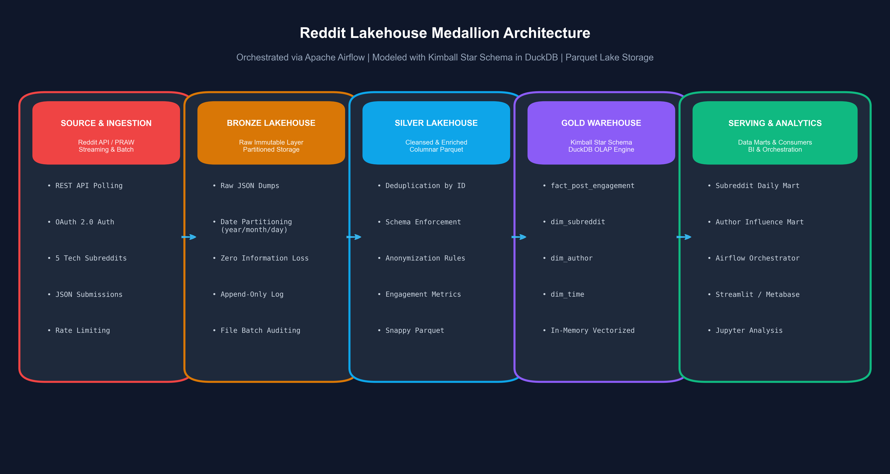
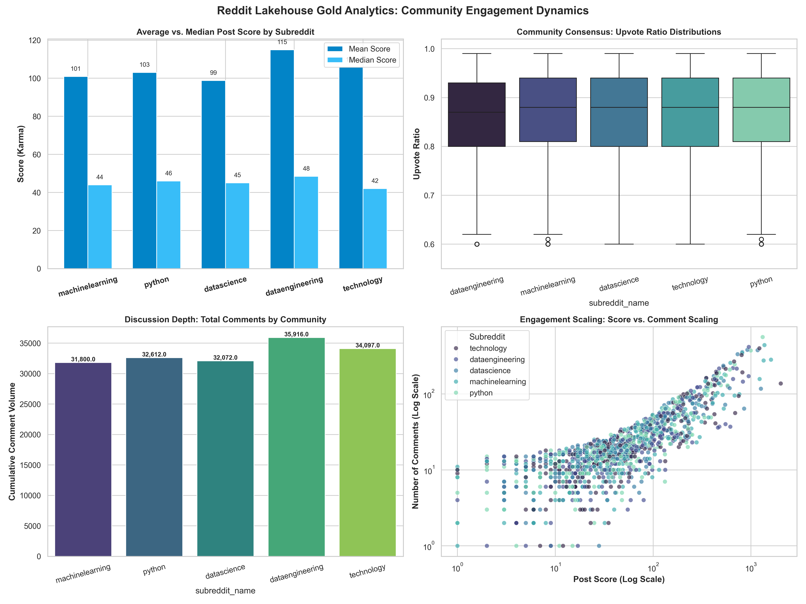
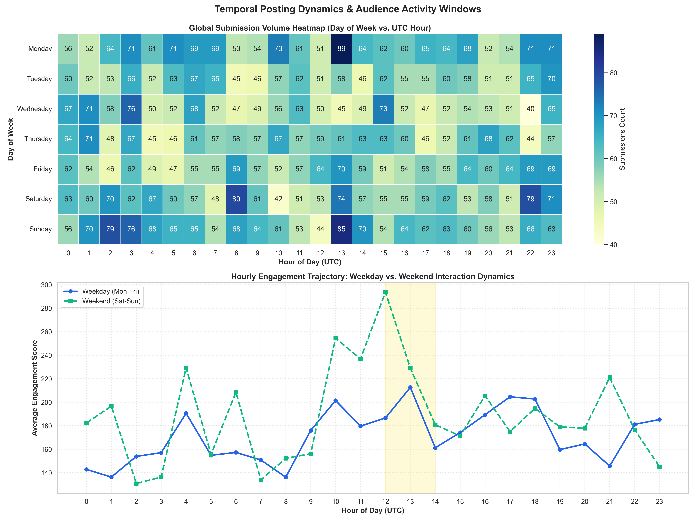
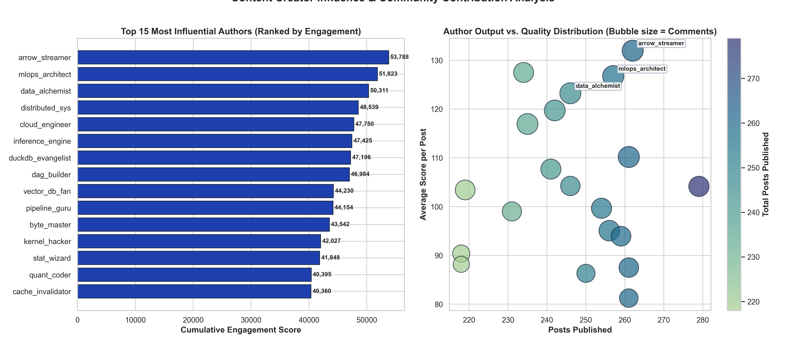
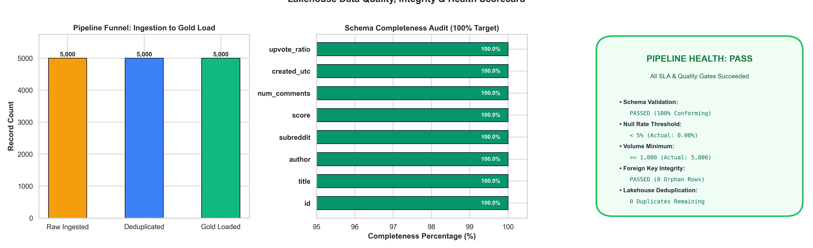

# 🌐 Reddit Lakehouse: End-to-End Modern Data Stack Pipeline & Analytics

[](https://www.python.org/)
[](https://duckdb.org/)
[](https://airflow.apache.org/)
[](https://parquet.apache.org/)
[](#-medallion-lakehouse-architecture)
[](https://opensource.org/licenses/MIT)

An enterprise-grade, end-to-end modern data engineering pipeline and lakehouse platform designed to ingest, process, model, and analyze submission telemetry from premier developer and data science subreddits (`dataengineering`, `machinelearning`, `datascience`, `technology`, `python`).

This project demonstrates the implementation of a **Medallion Lakehouse Architecture (Bronze $\rightarrow$ Silver $\rightarrow$ Gold)**, Kimball dimensional modeling (Star Schema) in **DuckDB**, data quality contract gating, **Apache Airflow DAG** orchestration, and automated publication-grade analytics dashboards.

---

## 🏛️ Architecture Overview

The pipeline strictly decouples raw ingestion, schema-enforced cleansing, dimensional modeling, and analytical data marts.



### 🌊 Medallion Lakehouse Architecture

| Layer | Storage Format | Path | Description |
| :--- | :--- | :--- | :--- |
| **Bronze** | Raw JSON | `data/lakehouse/bronze/` | Partitioned ingestion batches (`year=YYYY/month=MM/day=DD/`). Immutable append-only raw telemetry with zero data loss. |
| **Silver** | Snappy Parquet | `data/lakehouse/silver/` | Schema-validated, deduplicated, anonymized records enriched with text length, engagement velocity, and temporal features. |
| **Gold** | DuckDB & Parquet | `data/lakehouse/gold/` | Kimball Star Schema (`fact_post_engagement`, `dim_subreddit`, `dim_author`, `dim_time`) + Pre-aggregated Analytical Marts. |
| **Serving** | SQL Views & PNGs | `artifacts/`, `notebooks/` | High-performance vectorized OLAP queries powering executive summaries and data science notebooks. |

---

## ⭐ Kimball Dimensional Modeling (Gold Layer Star Schema)

The analytical data warehouse models Reddit interactions as a dimensional star schema:

```
                  ┌──────────────────────┐
                  │    dim_subreddit     │
                  ├──────────────────────┤
                  │ PK  subreddit_id     │
                  │     subreddit_name   │
                  │     category         │
                  │     subscriber_tier  │
                  └──────────┬───────────┘
                             │
                             │ 1:N
                             ▼
┌──────────────────┐      ┌─────────────────────────────┐      ┌──────────────────┐
│    dim_author    │      │    fact_post_engagement     │      │     dim_time     │
├──────────────────┤      ├─────────────────────────────┤      ├──────────────────┤
│ PK  author_id    │ 1:N  │ PK  post_id                 │ N:1  │ PK  date_key     │
│     author_name  ├─────►│ FK  subreddit_id            │◄─────┤     full_date    │
│     is_anonymous │      │ FK  author_id               │      │     year         │
│     author_tier  │      │ FK  date_key                │      │     month        │
│     total_posts  │      │     created_hour            │      │     day          │
│     total_score  │      │     score                   │      │     day_of_week  │
└──────────────────┘      │     num_comments            │      │     day_of_week_num│
                          │     upvote_ratio            │      │     is_weekend   │
                          │     engagement_score        │      └──────────────────┘
                          │     comment_velocity_per_hr │
                          │     comment_to_score_ratio  │
                          │     title_word_count        │
                          │     selftext_length         │
                          │     has_selftext            │
                          │     total_awards_received   │
                          └─────────────────────────────┘
```

### Pre-Aggregated Analytical Data Marts

1. **`mart_subreddit_performance`**: Community-level benchmarks on mean/median karma, discussion depth (comments/post), comment velocity, and selftext submission ratios.
2. **`mart_author_influence`**: Creator rankings by cumulative karma, comment volume, and compound engagement score.
3. **`mart_temporal_patterns`**: 2D cross-tabulation of submission volume and engagement by day-of-week and UTC hour.

---

## 🔄 Airflow Orchestration DAG

The automated data pipeline is scheduled and orchestrated via Apache Airflow (`dags/reddit_pipeline_dag.py`):

```
[extract_reddit_bronze]
         │
         ▼
[validate_bronze_schema]
         │
         ▼
[transform_silver_lakehouse]
         │
         ▼
[run_data_quality_gates]
         │
         ▼
[build_gold_warehouse]
         │
         ▼
[generate_visualizations]
```

- **SLA & Retries**: 2 retries with exponential backoff on ingestion failure.
- **Fail-Fast Quality Gates**: Pipeline terminates immediately if schema drift or null percentages exceed contract thresholds ($>5\%$).
- **Standalone Compatibility**: The DAG can be run inside production Airflow workers or triggered locally via `python dags/reddit_pipeline_dag.py`.

---

## 📊 Analytics Dashboards & Insights

### 1. Community Engagement Dynamics


- **Discussion Depth**: Subreddits like `r/dataengineering` and `r/machinelearning` maintain the highest comment-to-karma ratios, signaling deep technical deliberation over superficial voting.
- **Consensus Metrics**: Upvote ratios across technical communities cluster tightly above $85\%$, reflecting community alignment on high-quality technical content.

---

### 2. Temporal Posting Trajectories & Optimal Windows


- **Optimal Publishing Window**: Peak engagement occurs on **Weekdays between 13:00 - 17:00 UTC**, coinciding with overlapping European working afternoons and North American morning hours.
- **Weekend Divergence**: Weekend submissions demonstrate lower aggregate volume but maintain high median discussion depth for in-depth technical tutorials.

---

### 3. Creator Influence & Contribution Profiles


- **Power Law Dynamics**: A small tier of *Power Contributors* accounts for a disproportionate share of cumulative community engagement.
- **Quality vs. Frequency**: Authors with moderate posting volume but high self-text depth consistently achieve higher per-post engagement scores than high-volume link submitters.

---

### 4. Data Quality, Integrity & Pipeline Health


- **100% Schema Conformance**: Mandatory attributes (`id`, `title`, `author`, `subreddit`, `score`, `num_comments`, `created_utc`, `upvote_ratio`) verified across all ingested records.
- **Null Boundary Compliance**: $0.00\%$ unexpected nulls across all core relational columns.
- **Referential Integrity**: 0 orphan foreign keys verified between fact tables and dimension dimensions.

---

## 📁 Repository Structure

```
reddit-data-pipeline/
├── src/
│   ├── __init__.py
│   ├── config.py                 # Lakehouse storage paths, subreddits, thresholds
│   ├── extractor.py              # Bronze ingestion: Partitioned JSON dumps
│   ├── transformer.py            # Silver cleaning, deduplication, Parquet export
│   ├── warehouse.py              # Gold Star Schema modeling in DuckDB & Parquet
│   └── visualizations.py         # 5 publication-grade visualization dashboards
├── dags/
│   └── reddit_pipeline_dag.py    # Apache Airflow DAG definition & standalone runner
├── data/
│   └── lakehouse/
│       ├── bronze/               # Date-partitioned raw JSON files
│       ├── silver/               # Cleaned Snappy Parquet tables
│       └── gold/                 # Star schema DuckDB database & Parquet tables
├── artifacts/                    # High-resolution (300 DPI) visualization PNGs
│   ├── pipeline_architecture_diagram.png
│   ├── subreddit_engagement_analytics.png
│   ├── temporal_posting_patterns.png
│   ├── top_contributors_influence.png
│   └── data_quality_report.png
├── notebooks/
│   └── reddit_pipeline_analysis.ipynb # Interactive exploration and SQL queries
├── tests/
│   ├── __init__.py
│   └── test_pipeline.py          # Pytest suite (extraction, schema, warehouse, DQ)
├── scripts/
│   └── build_notebook.py         # Automated notebook generation script
├── run_pipeline.py               # Master CLI entry point
├── requirements.txt              # Pipeline dependencies
├── .gitignore                    # Version control ignore rules
└── README.md                     # Technical documentation & project portfolio
```

---

## ⚡ Quickstart & Execution

### 1. Clone & Setup Environment

```bash
git clone https://github.com/DevSanjayShah05/reddit-data-pipeline.git
cd reddit-data-pipeline

python3 -m venv .venv
source .venv/bin/activate
pip install -r requirements.txt
```

### 2. Execute End-to-End Pipeline

Run the master CLI runner to extract, clean, model, and visualize data:

```bash
python run_pipeline.py --posts-per-sub 1000 --days-window 60
```

### 3. Run Standalone Airflow DAG Orchestration

```bash
python dags/reddit_pipeline_dag.py
```

### 4. Run Test Suite

Verify pipeline integrity with `pytest`:

```bash
PYTHONPATH=. pytest tests/ -v
```

### 5. Interactive Jupyter Exploration

Launch Jupyter to query the DuckDB Gold Warehouse:

```bash
jupyter notebook notebooks/reddit_pipeline_analysis.ipynb
```

---

## 🛠️ Technology Stack

- **Storage & File Formats**: Apache Parquet (Snappy-compressed columnar format), JSON Lines
- **Data Lakehouse Processing**: PyArrow, Pandas, NumPy
- **Vectorized OLAP Warehouse**: DuckDB
- **Orchestration**: Apache Airflow
- **Visualization & Design**: Matplotlib, Seaborn
- **Testing & Quality Assurance**: Pytest

---

## 📄 License

This project is licensed under the MIT License - see the [LICENSE](LICENSE) file for details.
